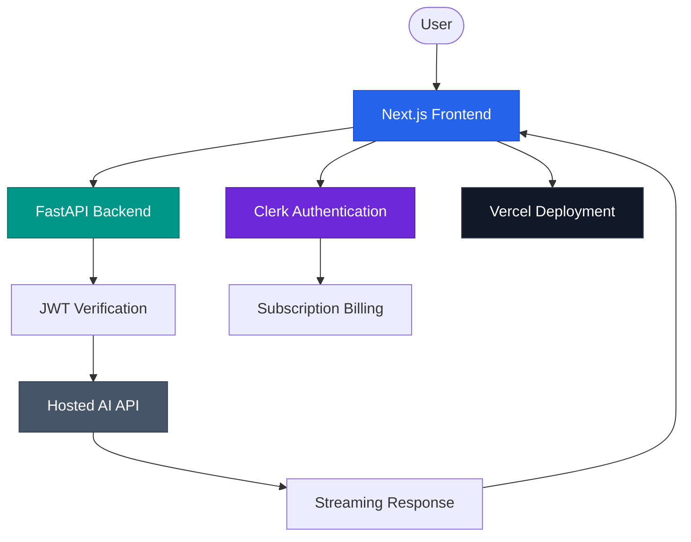
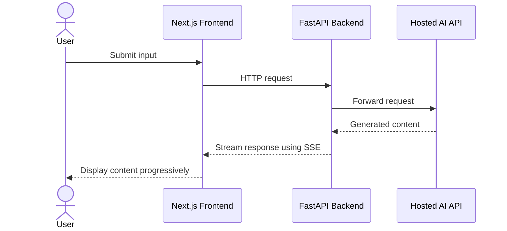
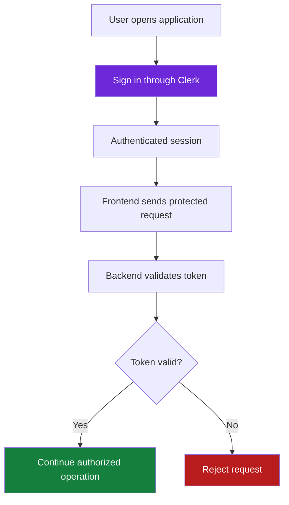

# Fullstack AI Lab

*A hands-on exploration of full-stack AI application development.*

An experimental project exploring how modern web technologies, AI services, authentication, subscription billing, and cloud deployment work together to build a full-stack application.

  
  
  
  
  
  
  

---

## Overview

The goal of this project is to explore how individual technologies connect to form a working application, from frontend development and backend APIs to authentication, AI integration, and deployment.

Rather than being a finished commercial product, this repository documents a hands-on learning process involving implementation, customization, debugging, and experimentation.

## Application Preview

<!-- Add your actual application screenshot at docs/images/homepage.png -->

Manage Profiles , Billing , Subscriptions, Access Features

---

## Architecture Overview

The application explores communication between a web frontend, a Python backend, hosted AI services, and authentication infrastructure.

*Conceptual architecture illustrating the integrations being explored. The actual request and authorization flow depends on the implementation.*

## Technology Stack

| Area | Technologies |
|---|---|
| Frontend | Next.js, React, TypeScript |
| Styling | Tailwind CSS |
| Backend | Python, FastAPI |
| AI Integration | Hosted AI APIs |
| Authentication | Clerk |
| Subscription Billing | Clerk Billing |
| Streaming | Server-Sent Events (SSE) |
| Deployment | Vercel |
| Version Control | Git, GitHub |

---

## API Integration & Streaming

Exploring how the frontend communicates with a backend API, how requests reach an external AI service, and how generated content can be delivered progressively.

**Concepts explored**
- HTTP requests and responses
- Frontend-to-backend communication
- External API integration
- Environment variables and API credentials
- Server-Sent Events (SSE)
- Streaming and error handling

<!-- Optional: add an actual screenshot of the AI interface below -->

<!--

  

-->

---

## Authentication & Authorization

Exploring how authentication providers manage user sessions and how protected backend endpoints can verify a user's identity.

**Concepts explored**
- User authentication and sessions
- JSON Web Tokens (JWTs)
- Backend token verification
- Protected routes and access control

Reference: [Clerk Documentation](https://clerk.com/docs)

<!-- Optional: add your actual sign-in or account screenshot -->

<!--

  

-->

---

## Subscription Billing

Exploring subscription-based application features and how billing can relate to user access.

Areas of interest include:
- Subscription plans
- Billing integration
- Access control for different plans
- Connecting authenticated users with subscription-related features

Reference: [Clerk Billing Documentation](https://clerk.com/docs)

*The billing section describes the concepts being explored; individual features may still be in progress.*

---

## Deployment & Development Workflow

Exploring the journey from local development to a hosted application using Git, GitHub, and Vercel.

**Concepts explored**
- Git and GitHub workflows
- Deployment configuration
- Environment variable management
- Build errors and debugging
- Deployment logs
- Preview and production environments

Reference: [Vercel Deployment Documentation](https://vercel.com/docs/deployments)

---

<!-- Optional: replace with an actual screenshot of your customized UI -->

<!--

  

-->

## What I'm Learning

- Building interfaces with Next.js, React, and TypeScript.
- Developing backend endpoints using Python and FastAPI.
- Integrating external APIs into web applications.
- Understanding HTTP communication and streaming responses.
- Exploring authentication and JWT verification.
- Learning about subscription billing and access control.
- Deploying applications and troubleshooting deployment issues.
- Managing environment variables and source control.

## Project Status

**In progress — experimental learning project.**

This repository documents ongoing exploration and implementation. Some features or integrations may be incomplete, and the application is not presented as a production-ready SaaS product.

## Learning Goal

To develop practical experience connecting frontend and backend technologies, integrating AI services, exploring authentication and billing, and deploying a full-stack application.

---

  <em>Learn by building. Experiment, debug, and improve.</em>

